# Portfolio

[](https://github.com/ilanbrunfman/portfolio/actions/workflows/server-tests.yml)
[](https://github.com/ilanbrunfman/portfolio/actions/workflows/client-checks.yml)

## Bank tracker (`/bank`)

A full-stack app to track bank accounts: balances, transactions, transfers
between accounts, filters and a monthly summary, behind an email + password
login. It runs locally: the React app talks to an Express API, which stores
everything in PostgreSQL running in Docker.

**Stack:** React 19 + Vite · Node 24 + Express 5 · Prisma 7 · PostgreSQL 17
(Docker) · Zod validation · Vitest + Supertest (43 API tests) · GitHub Actions

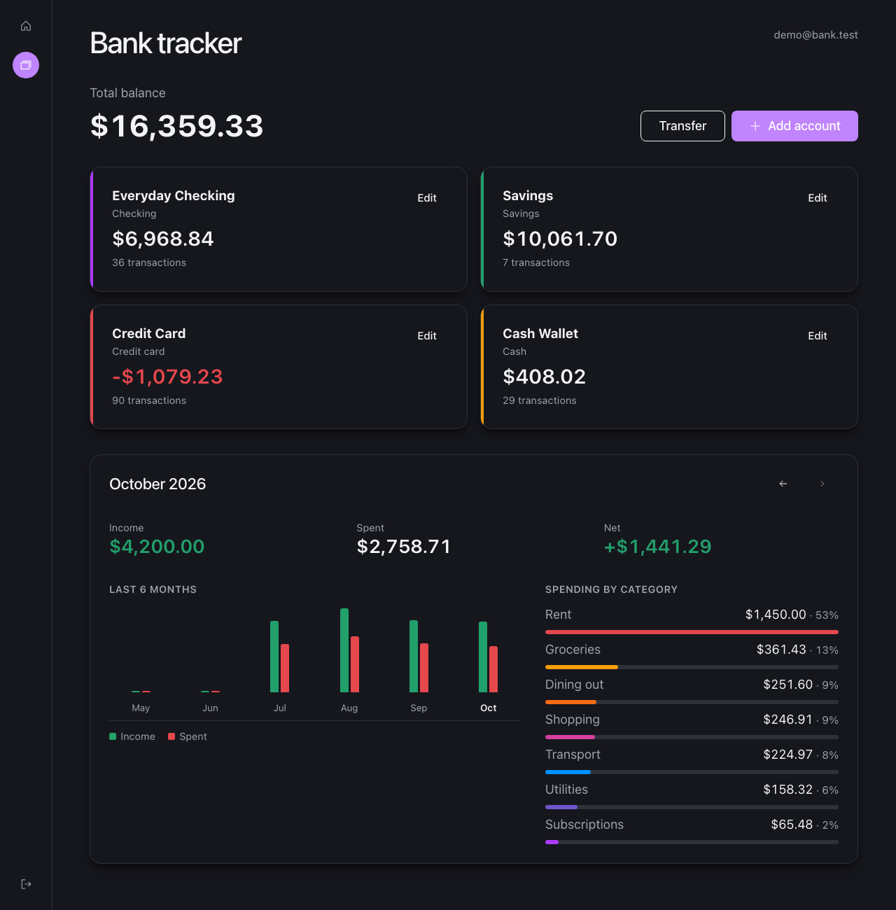

| Account page | Adding a transaction |
|---|---|
| 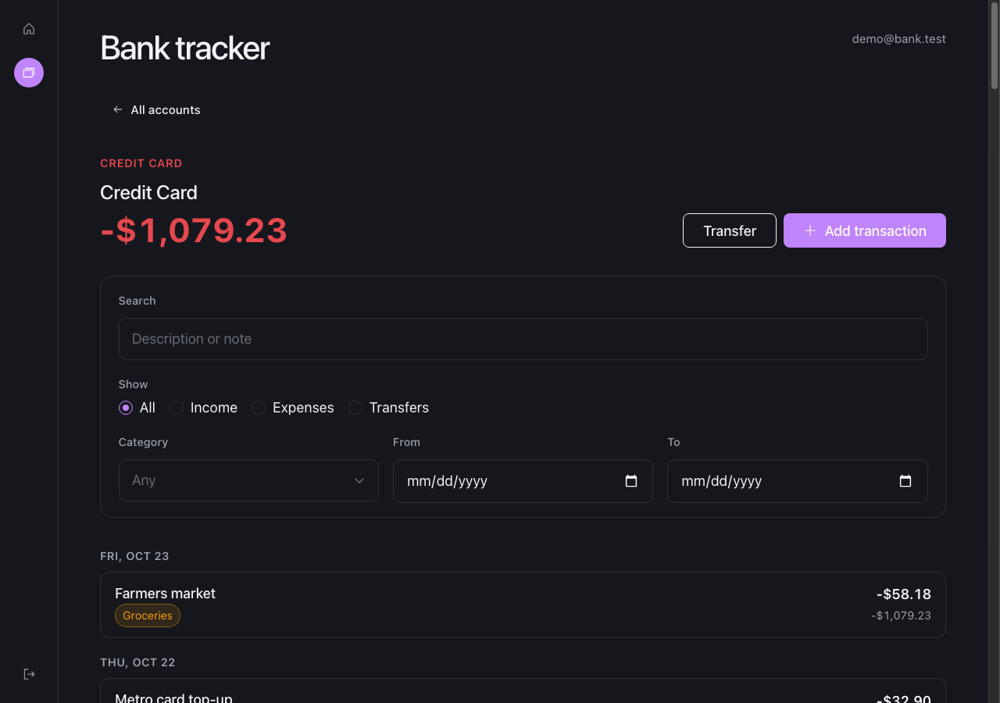 | 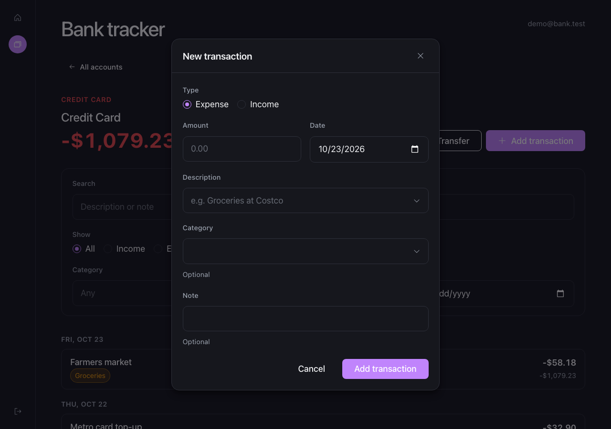 |

<p>
  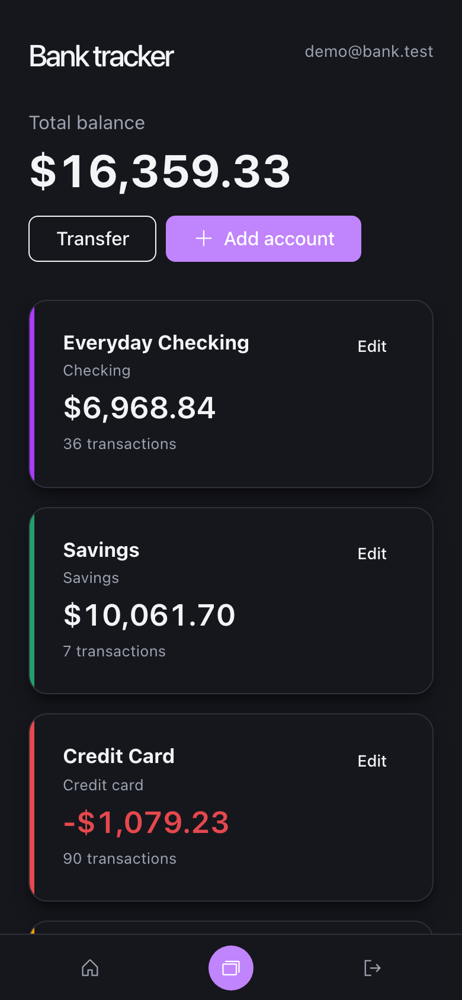
  &nbsp;
  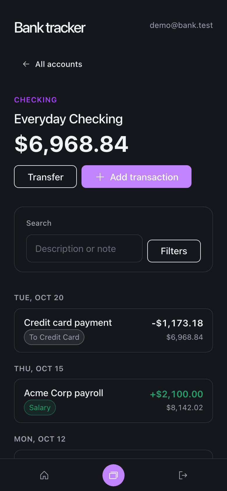
  &nbsp;
  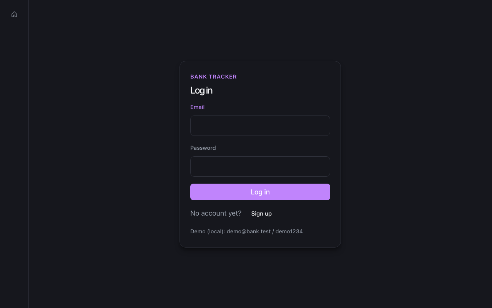
</p>

### What it does

- **Accounts** (checking, savings, credit card, cash) with balances computed in
  the database; archive and restore.
- **Transactions** with categories and notes; each row shows the balance after
  it (SQL window function), loaded 50 at a time.
- **Transfers** between accounts, saved inside a database transaction so both
  sides are written together or not at all.
- **Search and filters** (type, category, date range) and a **monthly summary**
  with spending by category and a 6-month chart.
- **Login** with hashed passwords and an httpOnly session cookie; every query
  is limited to the logged-in user's own data.
- **Responsive**: side navigation on desktop and tablet, a bottom bar on phones.

### Run it on your machine

Needs Docker Desktop and [nvm](https://github.com/nvm-sh/nvm).

```bash
# 1. API + database (Node 24)
cd server
cp .env.example .env        # then set a real POSTGRES_PASSWORD (also inside DATABASE_URL)
docker compose up -d        # PostgreSQL on localhost:5433
nvm use && npm install
npm run db:migrate
npm run db:seed             # demo data
npm run dev                 # API on http://localhost:4000

# 2. React app (Node 20), in a second terminal
cd client
nvm use 20 && npm install
npm run dev                 # open the printed URL + /bank
```

Log in as **demo@bank.test / demo1234**, or sign up for an empty account.

### Where things are

| Path | What |
|---|---|
| `client/src/pages/bank/` | React pages, components, contexts and hooks for `/bank` |
| `server/src/projects/bank/` | The bank API: routes, Zod schemas, services, login |
| `server/src/shared/` | What every project uses: database client, validation, errors, health check |
| `server/prisma/` | Database schema, migrations and the seed script |
| `server/test/` | API tests (`npm test` in `server/`, uses its own `bank_test` database) |
| `server/README.md` | Every endpoint, the login design, and all commands |

---

## Ta'im — restaurant app (`/taim`)

*Ta'im* (טעים) is Hebrew for "tasty". A restaurant system in the spirit of
Toast: staff pick who they are, seat tables and take orders, the kitchen
works a live list of tickets, and the manager sees each day's bills and what
dishes that came back cost. Same stack as the bank tracker, in its own
PostgreSQL schema next to the bank's.

**Stack:** React 19 + Vite · Node 24 + Express 5 · Prisma 7 · PostgreSQL 17
(Docker) · Zod validation · Vitest + Supertest (169 Ta'im API tests) · GitHub Actions

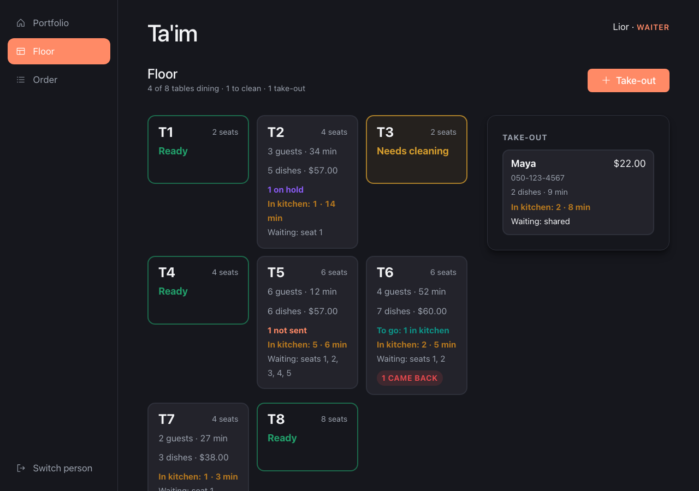

| A table's bill | The kitchen |
|---|---|
| 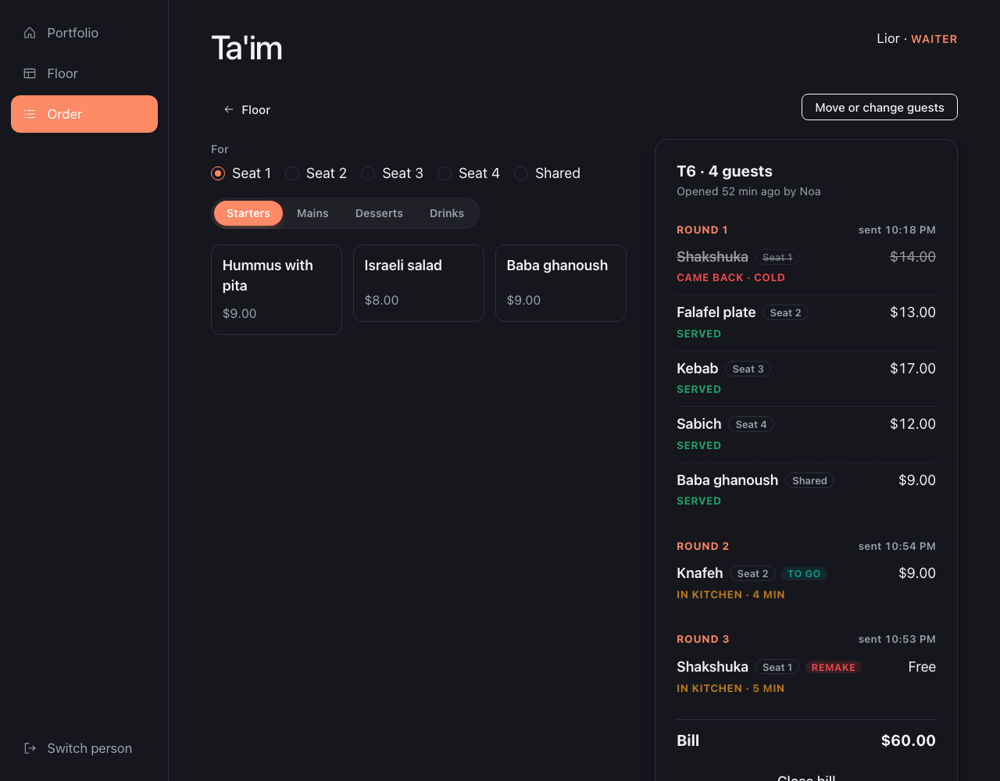 | 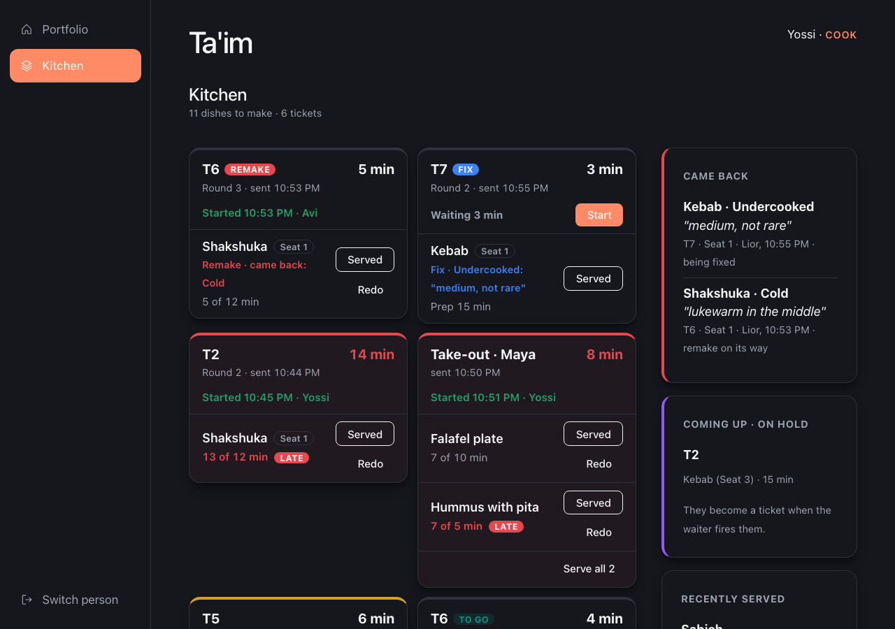 |

| Bills of the week | Losses |
|---|---|
| 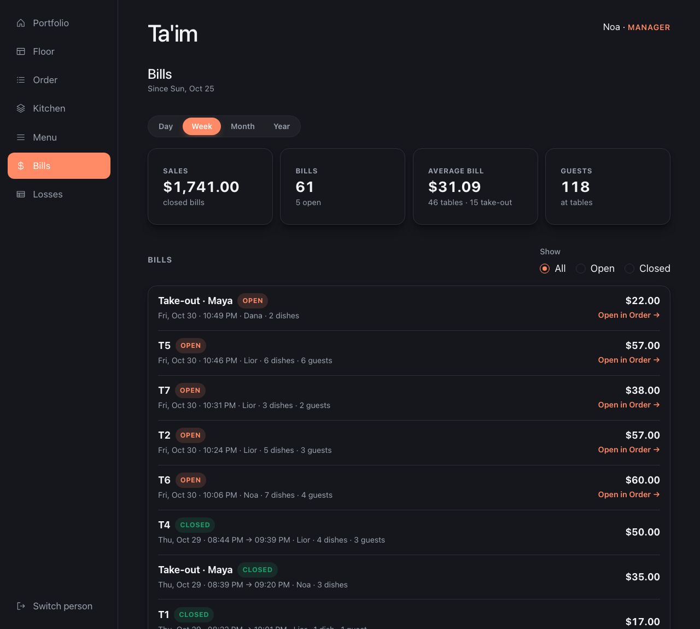 | 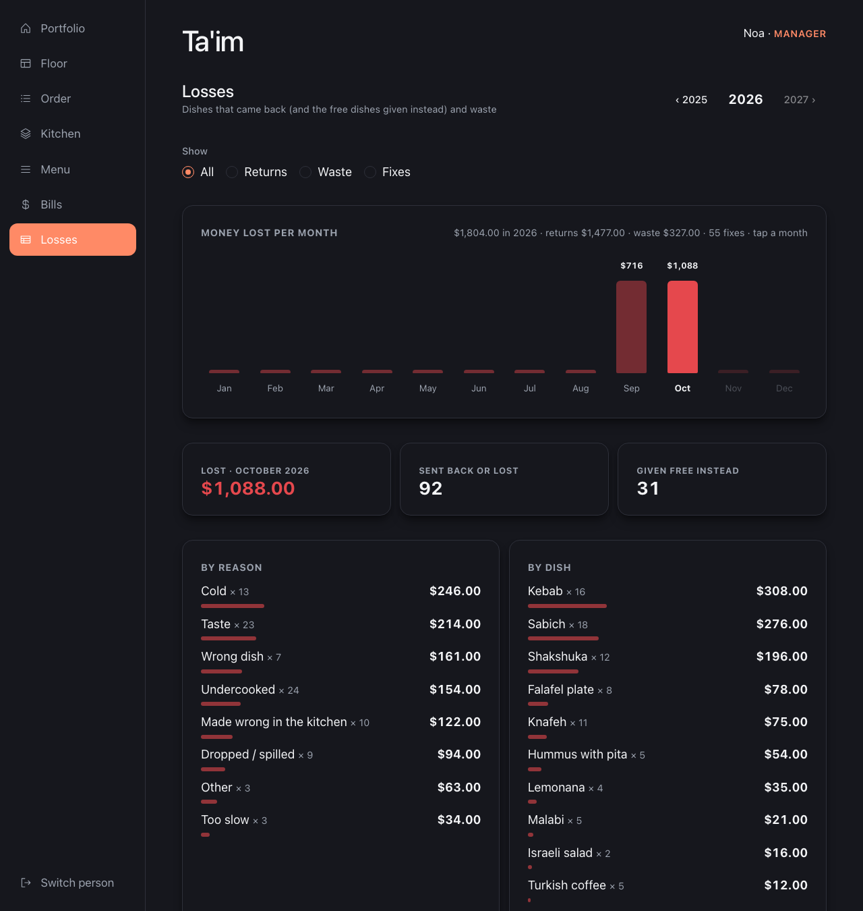 |

<p>
  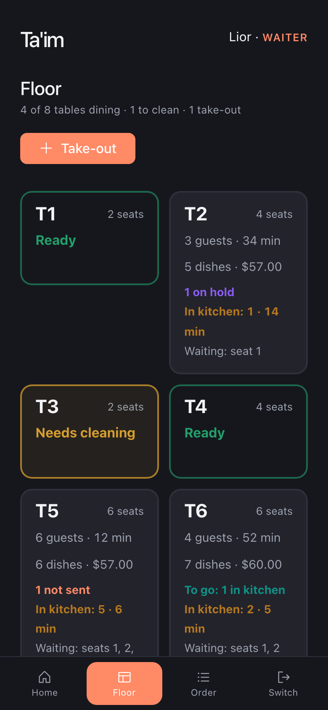
  &nbsp;
  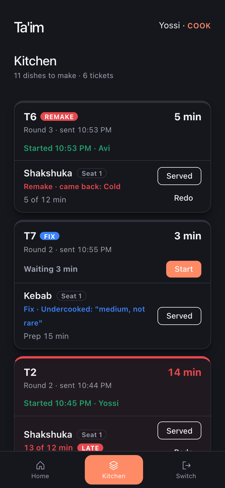
  &nbsp;
  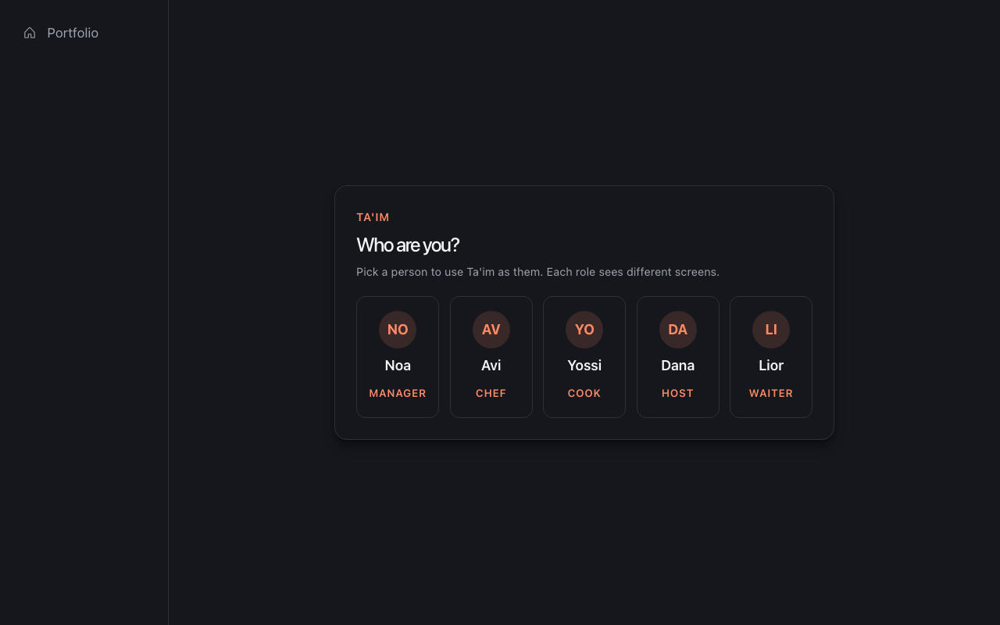
</p>

### What it does

- **Who are you?** Pick one of five people (Manager, Chef, Cook, Host,
  Waiter). There's no password: the role decides which screens you see, and
  the server checks it on every request (403 if your role can't).
- **Floor:** tables are green (ready), yellow (needs cleaning), grey (dining)
  or blue (all served), with what's not sent, on hold, in the kitchen or to
  go. Seat guests, combine tables for a big party, start take-outs, close
  bills. A table can't be seated twice, even by two hosts at once (a unique
  index in the database).
- **Order:** the menu by category; a dish for one or more seats or shared,
  to go or not. *Send to kitchen* asks what goes now and what waits on hold
  (mains after the starters), fired later by the waiter or the chef.
- **Kitchen:** one ticket per round, oldest first, refreshed every 5 seconds.
  A cook taps *Start*, each dish counts against its prep time (amber near
  it, red when late), then *Served*. Every dish keeps who sent, started and
  served it, and when.
- **When a guest sends a dish back:** fix the same plate (undercooked steak,
  more spice – still charged), or take it off the bill and make it again or
  give another dish instead (a dessert on us), free. Waste is recorded too:
  cancelled after cooking started, dropped, or made wrong (*Redo*).
- **Bills and end of day:** totals and every bill by day, week, month or
  year. The manager or chef closes the day (refused while bills are open),
  which saves a report and locks its bills; if nobody does, the server
  closes it at 04:00 restaurant time.
- **Losses:** money lost per month, by reason and by dish – returns, waste,
  and fixes (which cost nothing but are counted).
- **Prices are copied** when a dish is ordered, so a menu change never
  rewrites an old bill. Money is in whole cents; totals are calculated from
  rows, not stored.

### Run it

Same setup as the bank tracker above (Docker, `npm run db:migrate`,
`npm run db:seed`), then open the app + `/taim`. The seed gives a busy
evening (tables dining, tickets waiting, started, on hold, to go, a remake
and a fix) and eight weeks of history for Bills and Losses. Pick **Lior**
(Waiter) for the floor and orders, **Yossi** (Cook) for the kitchen, or
**Noa** (Manager) for everything.

### Where things are

| Path | What |
|---|---|
| `client/src/pages/taim/` | Screens (floor, order, kitchen, menu, bills, losses), components, hooks |
| `server/src/projects/taim/` | The Ta'im API: routes, Zod schemas, services, roles and rights (`roles.js`) |
| `server/prisma/schema/taim.prisma` | Its tables, in the PostgreSQL schema "taim" (CHECK rules added in the migrations) |
| `server/prisma/seeds/taim.js` | The demo restaurant |
| `server/test/taim/` | Its API tests (each rule was broken on purpose once to see a test fail) |

---
